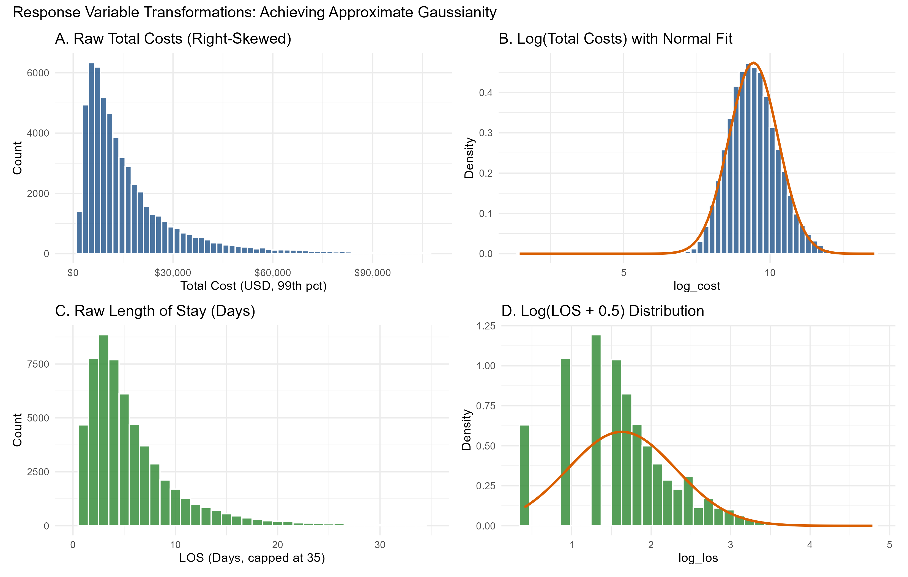
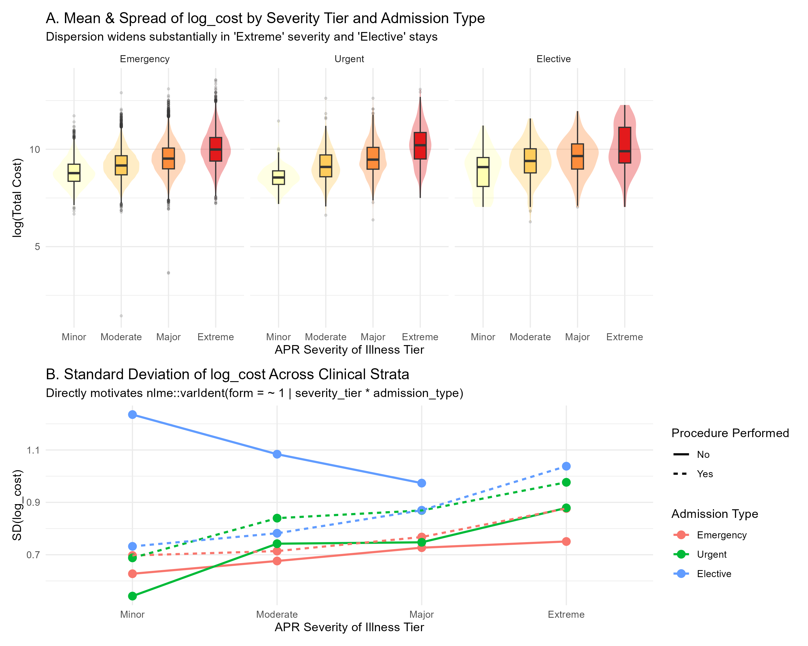
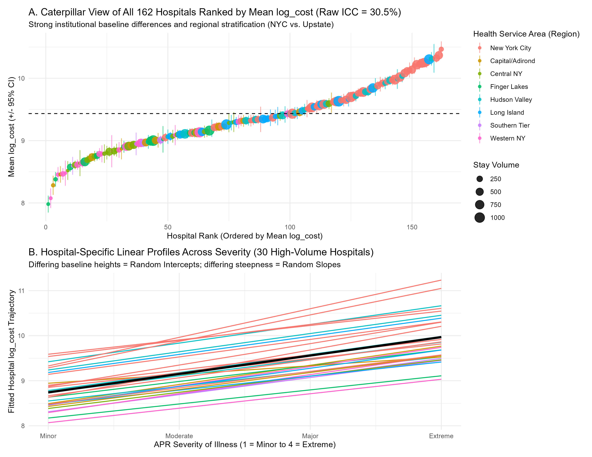
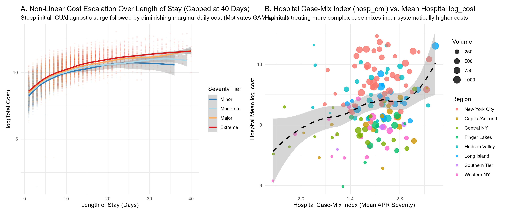

# Multilevel Mixed-Effects & Heteroscedastic Modeling of Hospital Provider Efficiency


## Overview
This repository contains the data pipeline and statistical analysis for our **Applied Statistics** course project at Politecnico di Milano. 

We analyze inpatient hospital discharge records for **Heart Failure (APR-DRG Code 194)** across New York State hospitals using de-identified data from the **NY Department of Health (SPARCS)** via Data.gov ($n = 14,559$ stays nested within $G = 122$ hospital providers). Our objective is to separate patient case-mix severity from institutional provider effects when benchmarking Length of Stay (LOS) and treatment costs.

---

## Project Roadmap & Current Status

- [x] **Phase 1: Data Acquisition (`01_data_preparation.R`)** — Automated Socrata API pagination pulling all 57,839 raw APR-DRG 194 records, initial filtering, and hospital-level covariate engineering (Volume, Case-Mix Index, ED Share).
- [x] **Phase 2: Data Cleaning & Validation (`02_data_cleaning.R`)** — Integrity checks, removal of redundant/constant columns, factor reference level encoding, and dataset export (`hospital_clean.csv`).
- [x] **Phase 3: Exploratory Data Analysis (`03_eda.R`)** — Distributional diagnostics, Bartlett/Levene variance heterogeneity tests, unadjusted ICC computation, GVIF multicollinearity checks, and Multiple Correspondence Analysis (MCA).
- [ ] **Phase 4: Heteroscedastic Linear Models (`04_heteroscedastic_gls.R`)** *(In Progress)* — Modeling group-specific variance across clinical severity tiers and admission types (`nlme::varIdent`, `varPower`).
- [ ] **Phase 5: Linear Mixed-Effects Models (`05_mixed_effects_lmm.R`)** *(Planned)* — Random hospital intercepts and random severity slopes (`lme4` / `nlme`) + empirical Bayes provider rankings (BLUPs).
- [ ] **Phase 6: Nonparametric Regression (`06_nonparametric_gamm.R`)** *(Planned)* — Generalized Additive Mixed Models (`mgcv`) for non-linear cost escalation curves over length of stay.

---

## Key Exploratory Findings (Motivating the Syllabus Models)

### 1. Response Transformation (`log_cost` & `log_los`)
Log-transforming raw hospital costs and length of stay resolves heavy right-skewness and satisfies Gaussian error assumptions.


### 2. Variance Heterogeneity Across Severity Tiers (Motivates Module 2: `varIdent`)
Cost dispersion increases across APR Severity of Illness tiers and is significantly wider in Elective and Procedural stays (Bartlett & Levene tests $p < 0.0001$).


### 3. Provider Hierarchy & Varying Severity Slopes (Motivates Modules 3 & 4: LMMs)
Roughly **25–30% of the total variance** in log-cost is attributable to between-hospital differences (unadjusted ICC), with distinct baseline levels and severity slopes across providers.


### 4. Non-Linear Cost Escalation (Motivates Module 5: GAMMs)
Treatment costs exhibit a steep initial surge during days 1–5 followed by diminishing marginal daily costs.


---

## How to Reproduce the Pipeline
1. Clone this repository:
   ```bash
   git clone [https://github.com/](https://github.com/)<your-username>/<your-repo-name>.git
